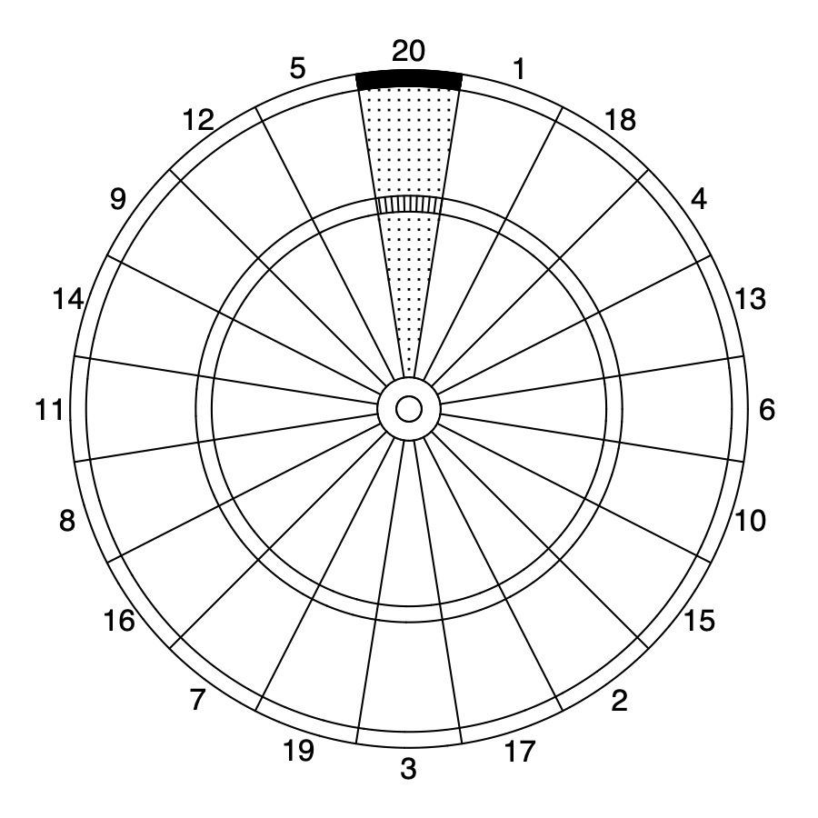

# darts

<!-- badges: start -->
[](https://github.com/ryantibs/darts/actions/workflows/R-CMD-check.yaml)
<!-- badges: end -->

R package for creating personalized score heatmaps, using tools from the paper
"[A Statistician Plays Darts](https://www.stat.berkeley.edu/~ryantibs/papers/darts.pdf)"
by Ryan Tibshirani, Andrew Price, and Jonathan Taylor (2011).

<p align="center">



</p>

## Installation

Install the development version from GitHub with:

```r
# install.packages("remotes")
remotes::install_github("ryantibs/darts")
```

## Usage

Throw a set of darts aimed at the center of the board, and record the scores
(use 0 for darts that miss the board). The package includes 100 such scores
as the example data `throws`.

First, estimate the spread of your throws. The simple model assumes a
Gaussian with the same variance in each direction; the general model allows
an arbitrary covariance matrix.

```r
library(darts)

fit <- simpleEM(throws)
sqrt(fit$s.final) 
#> [1] 28.26708 
```

Then compute your expected score for every aiming location, find the best
spot, and plot the heatmap:

```r
e <- simpleExpScores(fit$s.final)
aimSpot(e)
#>         x         y     score
#> -42.00000 -96.00000  15.03856

par(mar = c(0, 0, 0, 0))
drawHeatmap(e, board = TRUE, aim = TRUE)
```

Coordinates are in millimeters from the center of the board.
