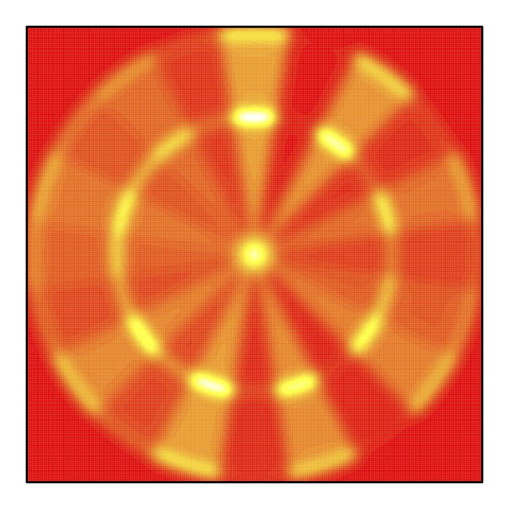
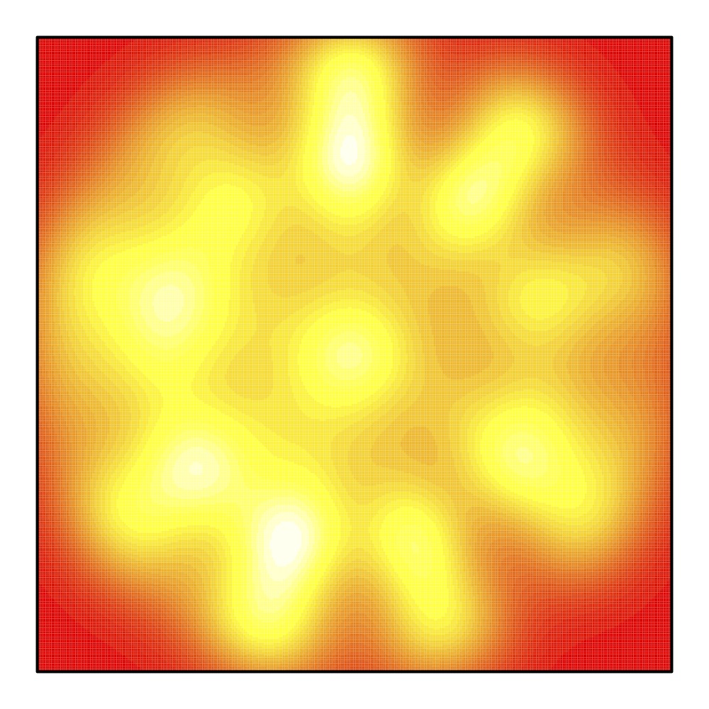

# darts

R package for creating personalized score heatmaps, using tools from the paper
[A Statistician Plays Darts](https://www.stat.berkeley.edu/~ryantibs/papers/darts.pdf)
by Ryan Tibshirani, Andrew Price, and Jonathan Taylor (2011).

  
  
  

